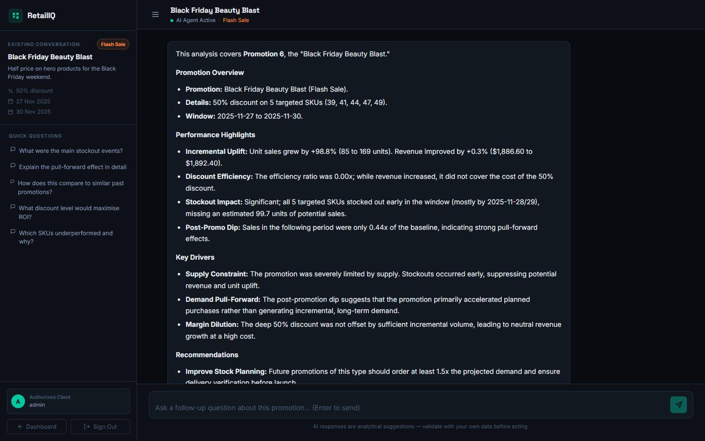
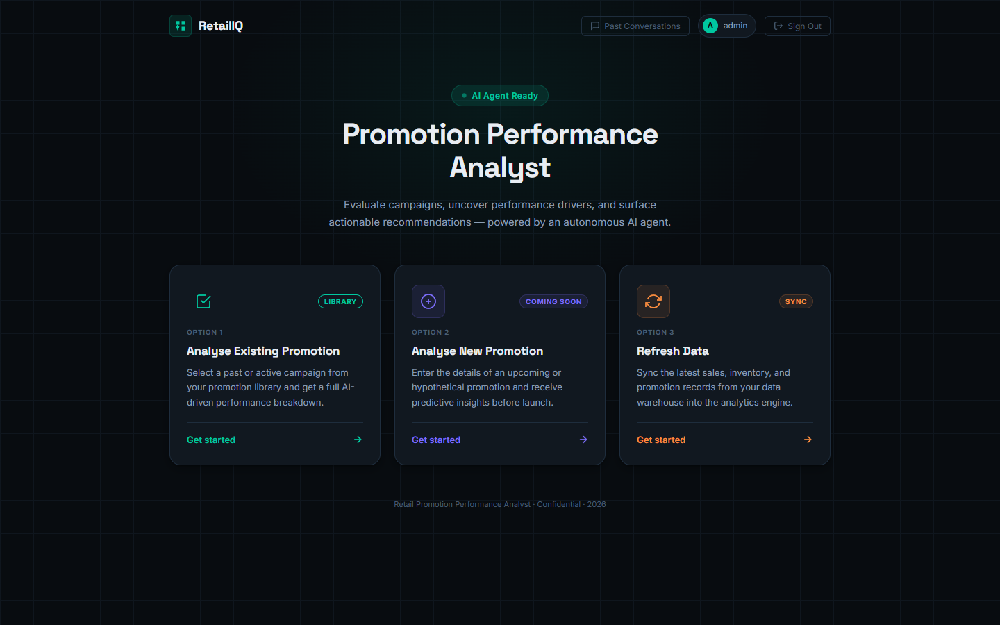
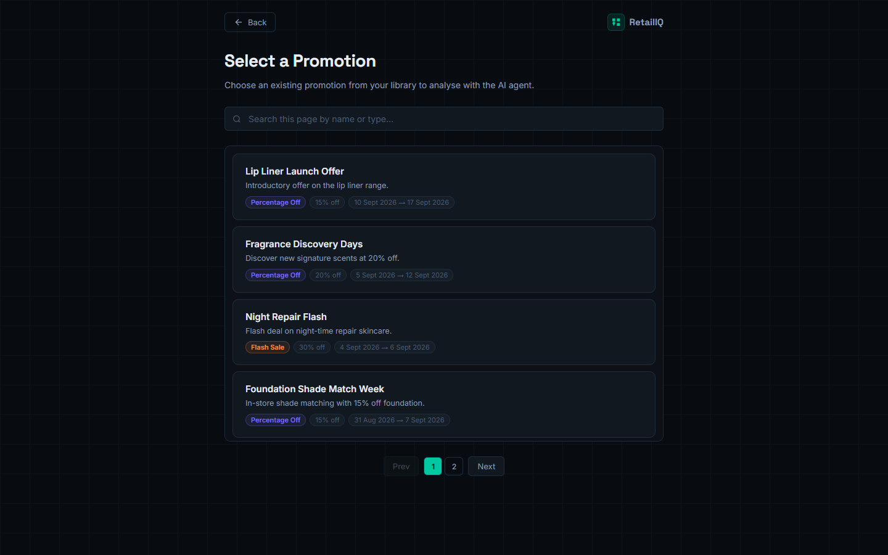
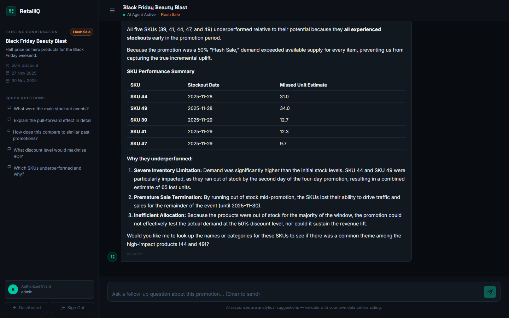
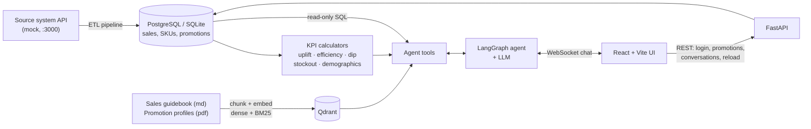

# RetailIQ: AI Promotion Performance Analyst

RetailIQ helps a retailer understand how its promotions really performed. Pick a promotion and an AI agent writes a performance briefing in seconds: did it lift sales, did the discount pay for itself, did it run out of stock, did demand collapse afterwards, and who bought it. Then you can ask follow-up questions in a chat.

Every number in an answer comes from a deterministic KPI tool run against the sales database, never from the language model's memory. The agent's job is to choose the right tools, read the results, and pull context from the company's sales guidebook and promotion briefs (retrieval-augmented generation).

*Internship project at Litmus7. It was originally built as two repositories, [backend](https://github.com/alfey504/retail-promotions-performance-analyzer-backend) and [frontend](https://github.com/alfey504/retail-promotions-performance-analyzer-frontend-react-vite). Both are combined here with their commit history, and the missing pieces were added so the whole system runs end to end.*



## Features

- **AI promotion briefing**: a LangGraph agent runs the KPI tools, searches the guidebook and promotion profiles, and writes an overview, highlights, key drivers and recommendations.
- **Follow-up chat** over WebSockets, with history saved per conversation.
- **Five KPI engines**: incremental uplift, discount efficiency, post-promotion dip (pull-forward), stockout trace with missed-sales estimate, and redemption demographics.
- **Hybrid RAG**: dense embeddings plus BM25, fused with reciprocal rank fusion in Qdrant, over a sales guidebook and per-promotion briefs.
- **Guarded SQL tool**: the agent can run ad-hoc read-only queries. They are checked, run in a read-only transaction, and kept away from the user and chat tables.
- **ETL pipeline**: loads products, SKUs, customers, promotions, deliveries and sales from the source system. The **Refresh Data** button re-runs it.
- **JWT login**, promotion library with search and paging, and past conversations you can resume.
- **Resilient demo mode**: with no LLM key, or when the model is unavailable or rate-limited, the chat still answers from the same KPI and search tools and says that it did.

| Dashboard | Promotion library | Follow-up question |
|---|---|---|
|  |  |  |

## Architecture



| Layer | Technology |
|---|---|
| Frontend | React 19, TypeScript, Vite |
| API | FastAPI, WebSockets, JWT (python-jose), Argon2 password hashing |
| Agent | LangGraph, LangChain tools; LLM via any OpenAI-compatible API (Cerebras `gpt-oss-120b` by default) or Gemini |
| Data | SQLAlchemy on PostgreSQL (Docker) or SQLite (local) |
| Retrieval | Qdrant (server or embedded), fastembed `bge-small-en-v1.5` + BM25, RRF fusion |
| Tooling | uv, npm, Docker Compose |

## Quick start

You need [uv](https://docs.astral.sh/uv/getting-started/installation/) (`winget install --id astral-sh.uv`) and [Node.js](https://nodejs.org) 20 or newer.

**Windows:** double-click `start.bat`.
**macOS / Linux:** `./start.sh`

Then open http://127.0.0.1:8000 and sign in with **admin / admin123**.

The launcher builds the frontend, starts the mock source API and the backend, and opens the browser. The first run also downloads the embedding models (about 100 MB), loads 60,000 sales rows and builds the search index, which takes 1 to 3 minutes. Later starts take a few seconds.

### Turn on the LLM agent

Without a key the app works in tools-only mode. For the full conversational agent, copy `backend/.env.example` to `backend/.env` and add a key. Free options:

| Provider | Get a key | Settings |
|---|---|---|
| Cerebras (original setup) | https://cloud.cerebras.ai | `LLM_API_KEY=...` (defaults to `gpt-oss-120b`) |
| Groq | https://console.groq.com | `LLM_API_KEY=...`, `LLM_BASE_URL=https://api.groq.com/openai/v1`, `LLM_MODEL=openai/gpt-oss-120b` |
| Google Gemini | https://aistudio.google.com/apikey | `LLM_PROVIDER=gemini`, `LLM_API_KEY=...`, `LLM_MODEL=gemini-3.1-flash-lite`, `LLM_FALLBACK_MODEL=gemini-3.5-flash` |

Restart the app after changing `.env`. The launcher prints which agent mode is active. Free tiers have small quotas (Gemini's `gemini-3.5-flash` allows only 20 requests a day, and one briefing uses several), so Cerebras or Groq is the better choice for a live demo.

### Run on PostgreSQL and a Qdrant server (Docker)

```bash
docker compose up --build
```

This runs PostgreSQL, Qdrant, the mock source API and the backend in containers, and serves the app on http://localhost:8000. LLM settings come from `backend/.env`.

### Development mode

```bash
cd backend && uv run python -m mock_source_api      # terminal 1: source API on :3000
cd backend && uv run python main.py                 # terminal 2: API on :8000
cd frontend && npm run dev                          # terminal 3: Vite on :5173, proxies /api to :8000
```

API docs are at http://127.0.0.1:8000/docs.

## The KPIs

| KPI | Formula | How to read it |
|---|---|---|
| Incremental uplift | Promotion units and revenue vs. an equal-length baseline window just before it | Clean win (both up), volume up / revenue down, or dud (both flat or down) |
| Discount efficiency | Incremental revenue ÷ total discount given | Above 1.0x, the promotion paid for its own discount |
| Post-promotion dip | Units in the equal-length window after ÷ baseline units | Below 0.75x means demand was pulled forward |
| Stockout trace | Day-by-day stock: opening stock + deliveries − sales | Flags SKUs that sold out with days left, and estimates the sales lost |
| Redemption demographics | Under-25 share of promoted sales vs. the customer base | 15+ points higher means the promotion over-indexed with younger shoppers |

## The data

The original source system (the API on port 3000 that the ETL pipeline reads from) is not part of the project repositories, and neither were the RAG documents. To make the system runnable, this repo includes:

- **`backend/mock_source_api/`**: a seeded generator and server for a fictional cosmetics retailer. It has 29 products, 62 SKUs, 1,200 customers, 38 promotions from October 2025 to September 2026, about 1,200 stock deliveries and about 60,000 sales lines. Inventory is simulated, so stockouts are real consequences of stock levels. Each promotion has a designed outcome (clean win, deep-discount loss, dud, pull-forward, stockout, young audience), so the analysis has real stories to find. It serves exactly the response format the original pipeline expects.
- **`backend/documents/sales_guidebook.md`**: KPI definitions, benchmark ranges and diagnostic playbooks.
- **`backend/documents/promotion_profiles.pdf`**: the marketing brief for each promotion, generated by `scripts/build_documents.py`.

All names, brands and figures are synthetic.

## Project structure

```
backend/
  main.py                 entry point: bootstrap, then serve API + built frontend
  bootstrap.py            first run: tables, demo user, data load, search index
  agent/                  LangGraph agent, prompts, persistence, tools-only fallback
  api/                    FastAPI app, routes, JWT auth, WebSocket chat
  tools/                  agent tools: KPI, lookup, SQL, RAG search
  services/
    kpi_services/         KPI calculators
    pipeline_services/    ETL from the source API into the database
    rag_services/         chunking, embeddings, Qdrant hybrid search
    db_services/          SQLAlchemy models and queries
  mock_source_api/        synthetic source system (port 3000)
  documents/              sales guidebook + promotion profiles for RAG
frontend/                 React + Vite single-page app
run.py, start.bat         one-command launcher
docker-compose.yml        PostgreSQL + Qdrant deployment
docs/DEMO.md              demo script for presentations
```

## What was added or fixed to make it run

The two original repositories were a working prototype that depended on services outside the repos. To make the combined project run end to end:

- **Integration**: the backend serves the built frontend from the same origin. The frontend reads its API address from the page origin or `VITE_API_BASE_URL` instead of a hard-coded URL. The Vite dev server proxies `/api` and WebSockets.
- **Runs anywhere**: SQLite when no `DB_CONN` is set, embedded Qdrant when no `QDRANT_URL` is set, and in-process fastembed embeddings instead of a separate embedding server. PostgreSQL, a Qdrant server and a TEI server still work through environment variables.
- **Startup**: `.env` is now actually loaded (it was never loaded, and `main.py` had an `env_file=".emv"` typo). The demo user the README promised is created. On first run the data is loaded and the documents are indexed, and they are re-indexed automatically when they change.
- **Dependencies**: removed the `jose` package (it clashes with `python-jose`), and added `argon2-cffi` (needed by the Argon2 password hashing) and `websockets`.
- **KPI fixes**: the stockout trace now counts units sold (it counted sale rows), includes deliveries during the window, and detects a stock-out as the shelf running empty (it only fired when stock went negative, which real data never does). Uplift with no baseline is reported as unavailable instead of 0%.
- **Agent**: the provider is configurable (Cerebras, Groq, Gemini, Ollama), with an optional fallback model and a tools-only fallback. The prompts now use the real tool names (they referred to tools that don't exist).
- **Safety**: the SQL tool runs in a read-only transaction and can't see the users or chat tables. The JWT secret is read from the environment.
- **Smaller fixes**: page count computed from the data (it was hard-coded to 14 pages), Data Refresh no longer blocks open chats, about 7x faster data loading (it was spending 2 s per request on IPv6 `localhost` lookups), the chat renders headings, tables and code from the LLM, past-conversation titles display correctly, and the frontend type-check error is fixed.

## License and credits

Built during an internship at Litmus7. Original repositories: [retail-promotions-performance-analyzer-backend](https://github.com/alfey504/retail-promotions-performance-analyzer-backend) and [retail-promotions-performance-analyzer-frontend-react-vite](https://github.com/alfey504/retail-promotions-performance-analyzer-frontend-react-vite).
